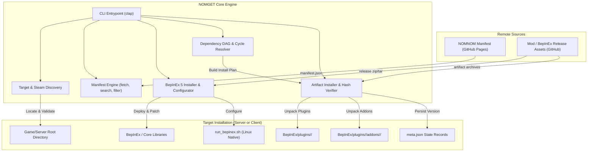

# NOMGET System Architecture

## 1. High-Level Architecture

NOMGET operates as a deterministic mod package manager and runtime launcher. The following diagram illustrates the interaction between external registries, the local filesystem, the Steam ecosystem, and the Unity/BepInEx runtime:



---

## 2. Module Specifications

### 2.1. `manifest` (NOMNOM Registry Client)
- **Source**: Defaults to `https://kopterbuzz.github.io/NOMNOM/manifest/manifest.json`. Accepts arbitrary URLs (`http://`, `https://`) or local filesystem paths for air-gapped testing.
- **Data Model**:
  - The compiled manifest is an array of `Mod` objects (`ManifestRaw::List`) or a map (`ManifestRaw::Map`).
  - `Mod`: Contains unique `id`, human-readable `displayName`, `description`, `tags`, `authors`, `isClientOrServer` (`"Client"`, `"Server"`, `"Both"`), and an array of versioned `Artifact`s.
  - `Artifact`: Contains `fileName`, `version`, `category` (`"release"`, `"preRelease"`), `gameVersion`, `downloadUrl`, `hash` (`sha256:...`), `dependencies` (`Vec<Dependency>`), `extends` (`Option<Extends>`), and `incompatibilities` (`Vec<Incompatibility>`).
- **Artifact Selection Strategy**:
  - If a specific version is requested, the matching artifact is selected.
  - If omitted, stable `"release"` category artifacts are prioritized, falling back to the latest listed artifact.

---

### 2.2. `target` (Environment & Discovery Engine)
- **Classification**:
  - **`DedicatedServer`**: Identified by `NuclearOptionServer.x86_64`, `NuclearOptionServer.exe`, or `RunServer.sh`.
  - **`Client`**: Identified by `NuclearOption.x86_64` or `NuclearOption.exe`.
  - **`is_linux_native`**: `true` when targeting `.x86_64` ELF binaries.
- **Steam Auto-Discovery**:
  - **Windows**: Queries registry `HKCU\Software\Valve\Steam\SteamPath`, reads `steamapps/libraryfolders.vdf` or `config/libraryfolders.vdf`.
  - **Linux**: Scans standard paths:
    - `~/.local/share/Steam`
    - `~/.steam/steam`
    - `~/.var/app/com.valvesoftware.Steam/.local/share/Steam` (Flatpak)
    - `~/snap/steam/common/.local/share/Steam` (Snap)
  - **VDF Parsing**: Implements standard line-based token parsing (`str::split('"')`) to extract all configured library mounts without requiring external heavy regex crates.
  - **Known Candidates**: Searches library folders for `steamapps/common/Nuclear Option` (AppID `2168680`) and `steamapps/common/Nuclear Option Dedicated Server` (AppID `3930080`).

---

### 2.3. `bepinex` (Runtime Hook Deployer)
- **Artifacts**:
  - **Linux x64 Native**: `https://github.com/BepInEx/BepInEx/releases/download/v5.4.23.4/BepInEx_linux_x64_5.4.23.4.zip`
  - **Windows x64**: `https://github.com/BepInEx/BepInEx/releases/download/v5.4.23.4/BepInEx_win_x64_5.4.23.4.zip`
- **Linux Native Configuration Pipeline**:
  1. Extracts archive into target root (`BepInEx/`, `libdoorstop.so`, `run_bepinex.sh`).
  2. Inspects `run_bepinex.sh` and substitutes `executable_name=""` with the exact binary name (e.g., `NuclearOptionServer.x86_64`).
  3. Applies POSIX executable permissions (`0o755`) to `run_bepinex.sh` and the game binary.
  4. Generates `BepInEx/config/BepInEx.cfg` with:
     ```ini
     [Chainloader]
     HideManagerGameObject = true
     ```
  5. Verifies installation completeness by ensuring `BepInEx/core/BepInEx.dll` exists.

---

### 2.4. `resolver` (Dependency DAG & Conflict Resolver)
- **Topological Resolution**:
  - Traverses dependencies recursively using Depth-First Search (DFS).
  - Maintains `in_progress: HashSet<String>` for cycle detection. If a cycle is detected, returns an error before mutating the filesystem.
  - Maintains `visited: HashSet<String>` to prevent duplicate processing.
  - Generates a linear `ResolutionPlan` where all upstream dependencies appear before dependents.
- **Add-on / Parent Resolution**:
  - Inspects `artifact.extends`. If an artifact extends another mod (e.g., a voice pack extending a utility), the parent mod is automatically resolved and installed first.
- **Incompatibility Verification**:
  - Cross-checks all planned artifacts against `incompatibilities` lists and emits warnings for conflicts.

---

### 2.5. `installer` (Artifact Deployment & State Persistence)
- **Integrity Validation**:
  - Evaluates artifact `hash` field (e.g., `sha256:<hex>`). Computes SHA256 of downloaded byte stream and rejects mismatches unless `--ignore-hash` is explicitly flagged.
- **Directory Layout & Root Preservation**:
  - If a zip archive contains a top-level `BepInEx/` or `plugins/` directory structure, it is extracted directly into the target root directory.
  - Otherwise, it is extracted into `<target>/BepInEx/plugins/<ModId>/`.
  - For extension add-ons (`extends`), it is extracted into `<target>/BepInEx/plugins/<ParentId>/addons/<ModId>/`.
- **State Persistence**:
  - Writes a `meta.json` file inside each installed mod's root folder:
    ```json
    {
      "id": "NOBlackBox",
      "artifact": {
        "fileName": "NOBlackBox-0.3.8.5.zip",
        "version": "0.3.8.5",
        "downloadUrl": "...",
        "hash": "..."
      }
    }
    ```
  - Allows `list-installed` and `update` commands to inspect local versions without re-downloading manifests.
- **Path Confinement (Zip-Slip Defense)**:
  - Validates all zip archive entry names using `file.enclosed_name()` to prevent directory traversal attacks (`../`).

---

## 3. Runtime Launch Mechanism

When `nomget target launch` is executed:
1. **Linux Native Targets**:
   - Executes `./run_bepinex.sh`.
   - Injects `LD_LIBRARY_PATH="$(pwd)/linux64:$LD_LIBRARY_PATH"` into the process environment so the dedicated server can bind Steamworks networking (`steamclient.so`).
   - Doorstop hooks `libdoorstop.so` via `LD_PRELOAD`, which initializes the Mono runtime and chainloads `BepInEx.dll` before Unity scene loading starts.
2. **Windows Targets**:
   - Executes the executable directly. Unity loads `winhttp.dll` automatically, which bootstraps Doorstop and BepInEx.
